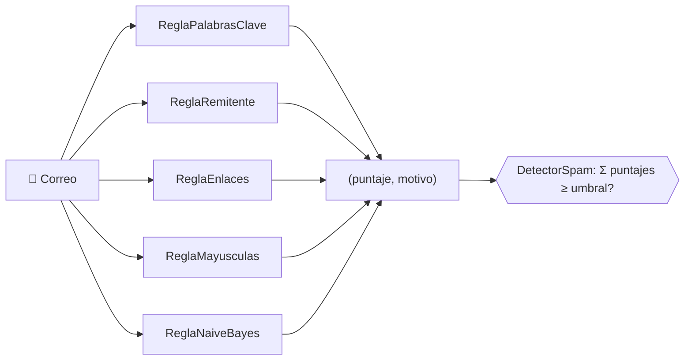
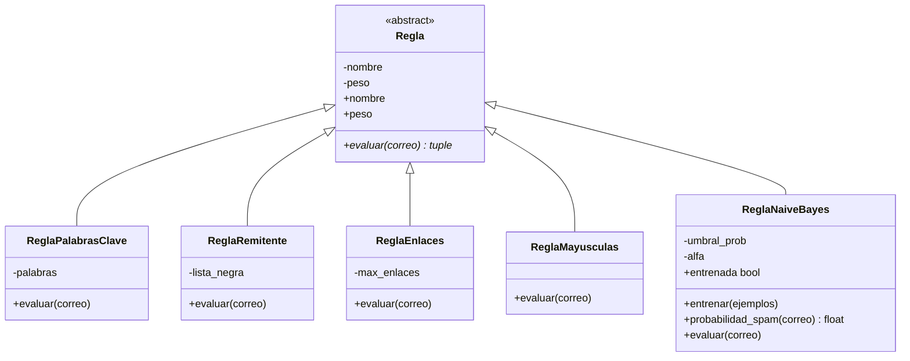

# 🧩 Módulo de Reglas — `Regla` y sus hijas

**Detector de Spam en Correos · Lenguaje de Programación II · Grupo 5 · 2026-2**

Este documento describe las **reglas de detección**: la clase base abstracta `Regla` y las cinco reglas que heredan de ella. Cada regla revisa un `Correo`, y si encuentra algo sospechoso devuelve **puntos** y un **motivo**. El `DetectorSpam` suma esos puntos y los compara con el umbral.

---

## 📑 Contenido

1. [Idea general](#-idea-general)
2. [Diagrama de clases](#-diagrama-de-clases)
3. [La clase base `Regla`](#-la-clase-base-regla)
4. [Reglas implementadas](#-reglas-implementadas)
5. [Naive Bayes: la regla que aprende](#-naive-bayes-la-regla-que-aprende)
6. [Ejemplos de uso](#-ejemplos-de-uso)
7. [Validaciones](#-validaciones)
8. [Cómo agregar una regla nueva](#-cómo-agregar-una-regla-nueva)
9. [Conceptos de POO en este módulo](#-conceptos-de-poo-en-este-módulo)

---

## 🎯 Idea general



**Contrato único:** toda regla recibe un `Correo` y devuelve una tupla `(puntaje, motivo)`. Si la regla no se cumple, devuelve `(0, "")`.

---

## 🏗️ Diagrama de clases



---

## 🧱 La clase base `Regla`

Clase **abstracta** (`ABC`): no se puede crear una `Regla` genérica, solo sus hijas. Obliga a cada hija a implementar `evaluar()`.

| Miembro | Qué hace |
|---|---|
| `__init__(nombre, peso)` | Guarda el nombre y el peso. Lanza `ValueError` si el peso no es positivo |
| `nombre`, `peso` | Propiedades de solo lectura (los atributos reales son privados) |
| `evaluar(correo)` | **Abstracto.** Cada hija lo implementa y devuelve `(puntaje, motivo)` |
| `__str__()` | Texto legible, por ejemplo `Remitente sospechoso (peso 5)` |

Las hijas llaman a `super().__init__(nombre, peso)` y usan `self.nombre` y `self.peso` para leer esos datos.

---

## 📋 Reglas implementadas

| Regla | Qué evalúa | Puntos que aporta | Parámetros (valor por defecto) |
|---|---|---|---|
| `ReglaPalabrasClave` | Palabras sospechosas en asunto y cuerpo. **Ignora mayúsculas y tildes** y acepta plurales | `peso` por cada palabra distinta | `palabras` (*gratis, premio, urgente, ganaste, oferta*), `peso=2` |
| `ReglaRemitente` | Dominio del remitente en una lista negra, **incluidos sus subdominios** | `peso` una sola vez | `lista_negra` (*promo-ya.com, ganadores.net, gratis.xyz*), `peso=5` |
| `ReglaEnlaces` | Más de `max_enlaces` enlaces `http(s)://` en el cuerpo | `peso` una sola vez | `max_enlaces=2`, `peso=2` |
| `ReglaMayusculas` | Asunto en MAYÚSCULAS (más de 3 letras) o con 3 o más `!` | `peso` una sola vez | `peso=3` |
| `ReglaNaiveBayes` | Probabilidad de spam **aprendida de ejemplos** | `peso` si la probabilidad ≥ `umbral_prob` | `peso=3`, `umbral_prob=0.5`, `alfa=1.0` |

### Detalles que conviene saber

- **Subdominios:** `mail.promo-ya.com` sí cae en la lista negra, pero `xpromo-ya.com` **no** (es otro dominio).
- **Tildes y plurales:** "PREMIÓ" coincide con *premio* y "Ofertas" coincide con *oferta*.
- **Un solo golpe:** `ReglaMayusculas` suma `peso` una vez, aunque se cumplan las dos condiciones.

---

## 🤖 Naive Bayes: la regla que aprende

A diferencia de las otras cuatro, esta regla **no tiene palabras fijas**: aprende de correos ya etiquetados.

1. Se entrena con `entrenar([(correo, es_spam), ...])`, donde `es_spam` es `True` o `False`.
2. Cuenta qué palabras aparecen más en spam y cuáles en correos normales (con suavizado de Laplace, parámetro `alfa`).
3. Al evaluar un correo nuevo calcula `P(spam | correo)`. Si es ≥ `umbral_prob`, suma `peso` puntos como cualquier otra regla.

| Miembro | Qué hace |
|---|---|
| `entrenar(ejemplos)` | Aprende de pares `(correo, es_spam)`. Se puede llamar varias veces |
| `entrenada` | `True` si ya vio al menos un correo spam y uno normal |
| `probabilidad_spam(correo)` | Devuelve un valor entre 0 y 1 (0.5 si aún no está entrenada) |
| `evaluar(correo)` | Antes de entrenar **no opina**: devuelve `(0, "")` |

> ⚠️ **Con pocos ejemplos sus probabilidades son poco confiables.** Además, si un correo no contiene ninguna palabra conocida su probabilidad es exactamente 50 %, por eso conviene usar `umbral_prob=0.6` para exigir algo más de confianza.

---

## 💻 Ejemplos de uso

Salidas reales de las reglas con los parámetros por defecto:

```python
correo = Correo("ventas@promo-ya.com", "¡¡¡GANASTE UN PREMIO GRATIS!!!",
                "Haz clic: http://a.co http://b.co http://c.co")

ReglaPalabrasClave().evaluar(correo)
# (6, 'Palabras clave: contiene gratis, premio, ganaste')

ReglaRemitente().evaluar(correo)
# (5, 'Remitente sospechoso: remitente en lista negra (promo-ya.com)')

ReglaEnlaces().evaluar(correo)
# (2, 'Enlaces: tiene 3 enlaces')

ReglaMayusculas().evaluar(correo)
# (3, 'Mayúsculas y exclamaciones: asunto en mayúsculas, muchos signos de exclamación')
```

Un correo normal no activa ninguna regla:

```python
normal = Correo("profe.vargas@lamolina.edu.pe", "Revisión del informe",
                "Adjunto la rúbrica de evaluación del trabajo grupal.")

ReglaPalabrasClave().evaluar(normal)   # (0, '')
```

Parámetros personalizados:

```python
ReglaPalabrasClave(palabras=["factura"], peso=4)   # una palabra propia, 4 puntos
ReglaEnlaces(max_enlaces=1, peso=3)                # más estricta con los enlaces
```

Naive Bayes entrenada con ejemplos:

```python
bayes = ReglaNaiveBayes(peso=3, umbral_prob=0.6)
bayes.evaluar(correo)                  # (0, '')  -> aún no está entrenada
bayes.entrenar([(correo_spam, True), (correo_normal, False)])

nuevo = Correo("z@x.com", "Premio gratis ya", "Gana dinero ahora")
bayes.probabilidad_spam(nuevo)         # 1.0
bayes.evaluar(nuevo)                   # (3, 'Naive Bayes: probabilidad de spam 100%')
```

Uso dentro del detector (el detector no necesita saber de qué tipo es cada regla):

```python
detector = DetectorSpam(umbral=5)
for regla in (ReglaPalabrasClave(), ReglaRemitente(), ReglaEnlaces(), ReglaMayusculas()):
    detector.agregar_regla(regla)
detector.analizar(correo)              # True -> es spam
```

---

## 🛡️ Validaciones

Los usos incorrectos producen errores claros en lugar de datos corruptos:

| Intento | Resultado |
|---|---|
| `Regla("x", 1)` | `TypeError`: la clase es abstracta |
| `ReglaEnlaces(peso=0)` | `ValueError`: el peso de una regla debe ser positivo |
| `ReglaNaiveBayes(umbral_prob=2)` | `ValueError`: `umbral_prob` debe estar entre 0 y 1 |
| `ReglaNaiveBayes(alfa=0)` | `ValueError`: `alfa` debe ser mayor que 0 |
| `detector.agregar_regla("texto")` | `TypeError`: solo se aceptan objetos `Regla` |

---

## ➕ Cómo agregar una regla nueva

Basta con crear una subclase de `Regla`, implementar `evaluar()` y registrarla. **No hay que modificar `DetectorSpam`.**

```python
class ReglaAdjuntos(Regla):
    """Penaliza correos que mencionan archivos ejecutables."""

    def __init__(self, peso=2):
        super().__init__("Adjuntos sospechosos", peso)

    def evaluar(self, correo):
        if ".exe" in correo.cuerpo.lower():
            return self.peso, f"{self.nombre}: menciona un archivo .exe"
        return 0, ""


detector.agregar_regla(ReglaAdjuntos())
```

Si olvidas implementar `evaluar()`, Python no te deja crear el objeto (`TypeError`), así que el error aparece al instante y no a mitad de un análisis.

---

## 🧠 Conceptos de POO en este módulo

| Concepto | Dónde se aplica |
|---|---|
| **Abstracción** | `Regla` es abstracta y define **qué** debe hacer una regla (`evaluar`) sin decir **cómo** |
| **Herencia** | Las cinco reglas heredan `nombre`, `peso` y `__str__` de `Regla` |
| **Polimorfismo** | `DetectorSpam` llama a `regla.evaluar(correo)` sin conocer el tipo concreto de cada regla |
| **Encapsulamiento** | Atributos privados (`__nombre`, `__peso`, …) leídos por `@property`; datos validados en el constructor |
| **Composición** | `DetectorSpam` guarda una lista de reglas |
| **Abierto/cerrado** | Se agregan reglas nuevas sin modificar el detector (`ReglaNaiveBayes` es la prueba) |

---
