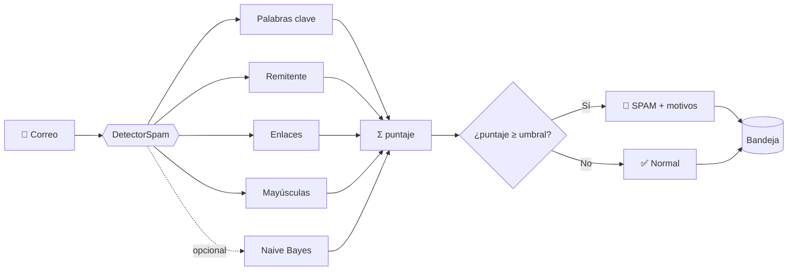
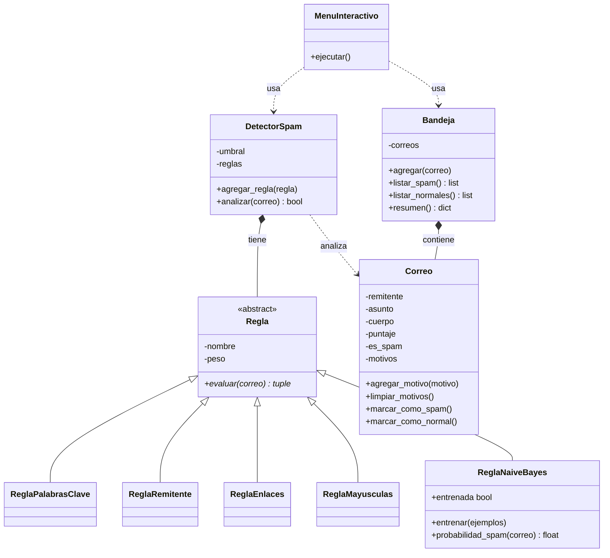

<div align="center">


# 📧 Detector de Spam en Correos

**Programación Orientada a Objetos en Python · Jupyter Notebook · GitHub Flow**

*Universidad Nacional Agraria La Molina*
*Facultad de Economía y Planificación · Departamento Académico de Estadística e Informática*


**Evaluación Grupal 1 · Grupo 5 · La Molina, Lima, Perú**

</div>

---

## 👥 Equipo de trabajo

| N° | Integrante | Usuario |
|:--:|------------|:--:|
| 1 | Huamani Diestra, Miriam Vanessa | MVanessaHD |
| 2 | Meza Asto, Angel David | AngelMol0810 |
| 3 | Chavez Cuzcano, Victor Javier | jchest771-stack |
| 4 | Alva Aquino, Brian | blolchevere-ctrl |

**Docente:** Vargas Paredes, Ana Cecilia

---

## 📑 Contenido

1. [Descripción del proyecto](#-descripción-del-proyecto)
2. [Equipo de trabajo](#-equipo-de-trabajo)
3. [Estado del proyecto](#-estado-del-proyecto)
4. [Arquitectura del sistema](#-arquitectura-del-sistema)
5. [Estructura del repositorio](#-estructura-del-repositorio)
6. [Flujo de trabajo (GitHub Flow)](#-flujo-de-trabajo-github-flow)
7. [Instalación y ejecución](#-instalación-y-ejecución)
8. [Ejemplos de uso y resultados](#-ejemplos-de-uso-y-resultados)
9. [Conceptos de POO aplicados](#-conceptos-de-poo-aplicados)
10. [Conclusiones](#-conclusiones)

---

## 🎯 Descripción del proyecto

Simulación de un **filtro de spam** implementado con **Programación Orientada a Objetos (POO)** en Python. Cada correo se revisa con un conjunto de **reglas independientes**; cada regla aporta puntos de "sospecha" y un motivo. El detector suma los puntos y, si el total alcanza un **umbral**, marca el correo como spam y **guarda los motivos** que explican la decisión.

### Funcionalidades

- 📥 Agregar correos a una bandeja.
- 🔍 Analizar cada correo con varias reglas.
- 🧾 Mostrar el puntaje y los motivos de cada decisión.
- 📋 Listar correos spam y normales.
- 🎚️ Cambiar el umbral de sensibilidad.
- 🤖 Sumar una regla opcional de **Naive Bayes** básico, que **aprende de ejemplos** y se integra como una regla más.

### Objetivos

- 🧱 Aplicar los pilares de la POO: **encapsulamiento, herencia, abstracción y polimorfismo**.
- 🌿 Trabajar en equipo con **Git y GitHub Flow**.
- 📓 Documentar el diseño, el código y las pruebas en un único informe en **Jupyter Notebook**.

### ¿Cómo funciona?



---

## 🚦 Estado del proyecto

El informe `informe.ipynb` sigue el orden del enunciado y **todas las secciones están completas y ejecutadas** (el cuaderno ya incluye las salidas):

| Sección del informe | Estado |
|---------------------|:------:|
| 1. Descripción del sistema | ✅ |
| 2. Arquitectura y diseño | ✅ |
| 3.1 Clase `Correo` | ✅ |
| 3.2 Clase base `Regla` + 5 reglas hijas (incluye `ReglaNaiveBayes`) | ✅ |
| 3.3 Clase `DetectorSpam` | ✅ |
| 3.4 Clase `Bandeja` | ✅ |
| 4. Ejecución de prueba (5 pasos) | ✅ |
| 5. Menú interactivo con `input()` | ✅ |
| 6. Informe: clases, atributos y métodos | ✅ |
| 7. Conceptos de POO aplicados | ✅ |
| 8. Conclusiones | ✅ |

---

## 🏗️ Arquitectura del sistema

```text
Bandeja ──contiene──▶ Correo ◀──analiza── DetectorSpam ──tiene──▶ Regla
                                                                    ▲
         ┌──────────────────┬─────────────────┬──────────────┬──────┴─────────┬────────────────┐
 ReglaPalabrasClave   ReglaRemitente   ReglaEnlaces   ReglaMayusculas   ReglaNaiveBayes
```

### Diagrama de clases



### Relaciones entre clases

| Relación | Tipo | Significado |
|----------|------|-------------|
| `Bandeja` → `Correo` | Composición | La bandeja guarda una lista de correos |
| `DetectorSpam` → `Regla` | Composición | El detector guarda una lista de reglas |
| `DetectorSpam` ⇢ `Correo` | Dependencia | El detector analiza y modifica un correo |
| `ReglaXxx` ⇒ `Regla` | Herencia | Cada regla especializa a la clase base |

### Flujo de una decisión

`Bandeja.agregar(correo)` → `DetectorSpam.analizar(correo)` → cada `Regla.evaluar(correo)` devuelve `(puntaje, motivo)` → el detector suma, guarda el puntaje y los motivos en el correo y lo marca como spam o normal → `Bandeja.listar_spam()` y `Bandeja.resumen()` muestran el resultado.

### Contrato entre clases

| Clase | Método | Recibe | Devuelve |
|-------|--------|--------|----------|
| `Regla` y sus hijas | `evaluar(correo)` | un `Correo` | tupla `(puntaje, motivo)` |
| `DetectorSpam` | `analizar(correo)` | un `Correo` | `True` si es spam |
| `Bandeja` | `listar_spam()`, `listar_normales()` | — | lista de `Correo` |

### Reglas implementadas

| Regla | Qué evalúa | Puntos que aporta |
|-------|------------|:-----------------:|
| `ReglaPalabrasClave` | Palabras como *gratis, premio, urgente, ganaste, oferta* en asunto y cuerpo. Ignora mayúsculas y tildes y acepta plurales | `peso` por palabra distinta (2) |
| `ReglaRemitente` | Dominio del remitente en lista negra (`promo-ya.com`, `ganadores.net`, `gratis.xyz`), incluidos sus subdominios | 5 |
| `ReglaEnlaces` | Más de `max_enlaces` enlaces `http(s)://` en el cuerpo | 2 (máx. por defecto: 2) |
| `ReglaMayusculas` | Asunto en MAYÚSCULAS o con 3+ signos de exclamación | 3 |
| `ReglaNaiveBayes` | Probabilidad de spam **aprendida de ejemplos** (Naive Bayes multinomial con suavizado de Laplace). Sin entrenar, no opina | 3 si la probabilidad ≥ `umbral_prob` (0.5 por defecto; 0.6 en la demo) |

> 💡 **Extensible:** para agregar una regla nueva basta con crear una subclase de `Regla` que implemente `evaluar()` y registrarla con `detector.agregar_regla(...)`. No hay que modificar `DetectorSpam`.

---

## 📁 Estructura del repositorio

```text
Detector-spam-correos/
├── images/
│   └── logo_UNALM.png      # Logo de la portada de este README
├── informe.ipynb           # Informe y código del proyecto (todas las clases)
└── README.md               # Este archivo
```

> Todo el código vive dentro de `informe.ipynb`: **el orden de las celdas importa**, cada clase se define antes de usarse.

---

## 🌿 Flujo de trabajo (GitHub Flow)

- `main` siempre contiene código estable.
- Cada funcionalidad se desarrolla en **su propia rama** (`Clase_<nombre>`, por ejemplo `Clase_bandeja`).
- Los cambios llegan a `main` solo mediante un **Pull Request** revisado por el equipo.

```bash
git checkout main && git pull origin main
git checkout -b Clase_bandeja                  # 1. nueva rama
git add informe.ipynb
git commit -m "feat(bandeja): agrega clase Bandeja"   # 2. commit
git push -u origin Clase_bandeja               # 3. push → abrir Pull Request en GitHub
```

Después de la revisión y el **Merge pull request**, sincroniza tu copia local:

```bash
git checkout main && git pull origin main
git branch -d Clase_bandeja
```

> ⚠️ **Cuidado con el notebook:** como todo el equipo edita el mismo `informe.ipynb`, los conflictos de merge son más probables que con archivos `.py`. Conviene que cada integrante trabaje **sus propias celdas** y hacer `git pull origin main` con frecuencia.

| Prefijo | Uso | Ejemplo |
|---------|-----|---------|
| `feat` | Nueva funcionalidad | `feat(reglas): agrega ReglaNaiveBayes` |
| `fix` | Corrección de un error | `fix(detector): valida el umbral` |
| `docs` | Documentación | `docs: actualiza README` |
| `refactor` | Mejora interna sin cambiar el comportamiento | `refactor(correo): agrega motivos` |

---

## 🚀 Instalación y ejecución

**Requisitos:** Python 3.8 o superior y Jupyter. El código solo usa la biblioteca estándar (`re`, `math`, `unicodedata`, `abc`).

```bash
# 1. Clonar
git clone https://github.com/<usuario-o-organizacion>/Detector-spam-correos.git
cd Detector-spam-correos

# 2. Abrir el informe
pip install notebook
jupyter notebook informe.ipynb
```

Dentro de Jupyter, ejecuta **Run → Run All Cells** (o celda por celda, de arriba hacia abajo).

---

## 📊 Ejemplos de uso y resultados

### Uso básico

```python
detector = DetectorSpam(umbral=5)
for regla in (ReglaPalabrasClave(), ReglaRemitente(), ReglaEnlaces(), ReglaMayusculas()):
    detector.agregar_regla(regla)

correo = Correo("ventas@promo-ya.com", "¡¡¡GANASTE UN PREMIO GRATIS!!!",
                "Haz clic: http://a.co http://b.co http://c.co")

es_spam = detector.analizar(correo)   # True / False
print(correo)                         # [SPAM] (16 pts) ...
print(correo.motivos)                 # lista de motivos detectados
```

### Resultado de la ejecución de prueba (umbral = 5)

Nueve correos de ejemplo analizados con las cinco reglas (Naive Bayes entrenada con 12 correos etiquetados, `umbral_prob=0.6`):

| Remitente | Asunto | Puntaje | Clasificación |
|-----------|--------|:-------:|:-------------:|
| `ventas@promo-ya.com` | ¡¡¡GANASTE UN PREMIO GRATIS!!! | 19 | 🚫 SPAM |
| `info@ganadores.net` | URGENTE: reclama tu premio | 12 | 🚫 SPAM |
| `profe.vargas@lamolina.edu.pe` | Revisión del informe | 0 | ✅ Normal |
| `compa@correo.com` | Reunión del grupo 5 | 0 | ✅ Normal |
| `soporte@tienda.com` | Oferta de temporada | 5 | 🚫 SPAM |
| `secretaria@lamolina.edu.pe` | URGENTE: confirma tu asistencia | 2 | ✅ Normal |
| `boletin@mail.promo-ya.com` | Boletín semanal | 5 | 🚫 SPAM |
| `hola@xpromo-ya.com` | Boletín semanal | 0 | ✅ Normal |
| `ventas@tiendaperu.com` | Ofertas gratis esta semana | 7 | 🚫 SPAM |

```text
=== RESUMEN DE BANDEJA ===
Total de correos : 9
Spam             : 5
Normales         : 4
Porcentaje spam  : 55.6%
```

Casos que muestran cómo se comporta el sistema:

- **Subdominios:** `mail.promo-ya.com` sí cae en la lista negra, pero `xpromo-ya.com` no.
- **Umbral:** una sola señal débil ("URGENTE", 2 pts) no basta para marcar spam.
- **Naive Bayes:** `soporte@tienda.com` solo suma 2 pts por palabras clave; con los 3 pts de Naive Bayes llega al umbral.

### Menú interactivo

`MenuInteractivo` ofrece: agregar un correo, reanalizar, ver spam (con motivos), ver normales, **cambiar el umbral**, entrenar Naive Bayes con la bandeja, ver reglas y ver el resumen. Valida entradas incorrectas (remitente sin `@`, umbral no numérico o `0`, opciones inexistentes). Para usarlo con el teclado, quita el `#` de la línea `MenuInteractivo(...).ejecutar()` en la sección 5 del cuaderno.

### Regla opcional: Naive Bayes

La regla se agrega como cualquier otra, pero **no opina hasta que vea al menos un correo spam y uno normal**:

```python
bayes = ReglaNaiveBayes()
detector.agregar_regla(bayes)
bayes.entrenar([(correo_spam, True), (correo_normal, False)])   # pares (correo, es_spam)

nuevo = Correo("a@b.com", "Premio gratis ya", "Haz clic http://x.co")
detector.analizar(nuevo)
print(nuevo)            # [SPAM] (7 pts) ...
print(nuevo.motivos)    # ['Palabras clave: contiene gratis, premio', 'Naive Bayes: probabilidad de spam 99%']
```

### Validaciones (encapsulamiento)

```text
Correo(...).puntaje = -1   →  ValueError: El puntaje no puede ser negativo
Regla("x", 1)              →  TypeError: Can't instantiate abstract class Regla ...
```


---

## 🧠 Conceptos de POO aplicados

| Pilar | Dónde se aplica |
|-------|-----------------|
| **Encapsulamiento** | Atributos privados (`__puntaje`, `__motivos`, …) con `@property`; el setter de `puntaje` valida que no sea negativo y `motivos` devuelve una **copia** de la lista interna |
| **Abstracción** | `Regla` es una clase abstracta (`ABC`): define el contrato `evaluar()` y no se puede instanciar |
| **Herencia** | Las 5 reglas heredan `nombre` y `peso` de `Regla` |
| **Polimorfismo** | `DetectorSpam.analizar()` llama a `regla.evaluar(correo)` sin conocer el tipo concreto de cada regla |
| **Composición** | `DetectorSpam` tiene reglas; `Bandeja` contiene correos |

---

## ✅ Conclusiones

- **Modularidad:** separar `Correo`, `Regla`, `DetectorSpam`, `Bandeja` y `MenuInteractivo` da a cada clase una sola responsabilidad.
- **Polimorfismo en acción:** `DetectorSpam` trata igual a las cinco reglas; agregar `ReglaNaiveBayes` no obligó a modificar el detector.
- **Encapsulamiento:** atributos privados, propiedades y validaciones convierten los usos incorrectos en excepciones claras.
- **Umbral y varias señales:** una sola señal débil no marca spam; la suma de varias sí.
- **Limitaciones:** pesos, umbral y palabras clave están elegidos a mano, y Naive Bayes aprende de solo 12 ejemplos; no se midió la precisión con datos reales.

### 🔭 Mejoras futuras

- Pruebas automatizadas con `pytest`.
- Cargar correos desde archivos CSV o `.eml`.
- Ajustar pesos y umbral con datos reales y medir precisión.
- Nuevas reglas, por ejemplo adjuntos sospechosos o dominios recién creados.

---

<div align="center">

**Grupo 5 · Lenguaje de Programación II · UNALM · 2026-2**

</div>
